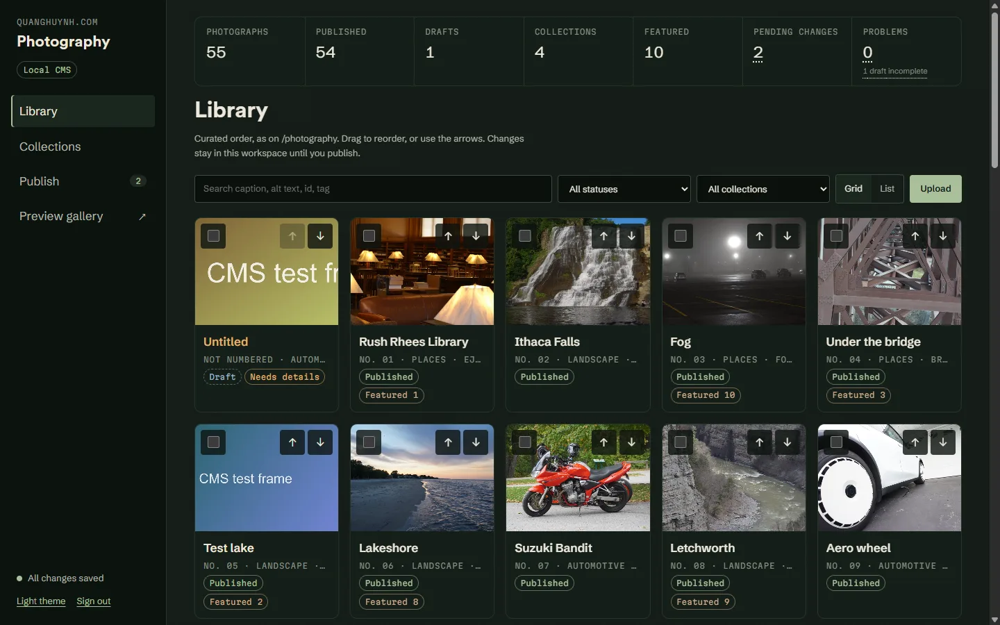
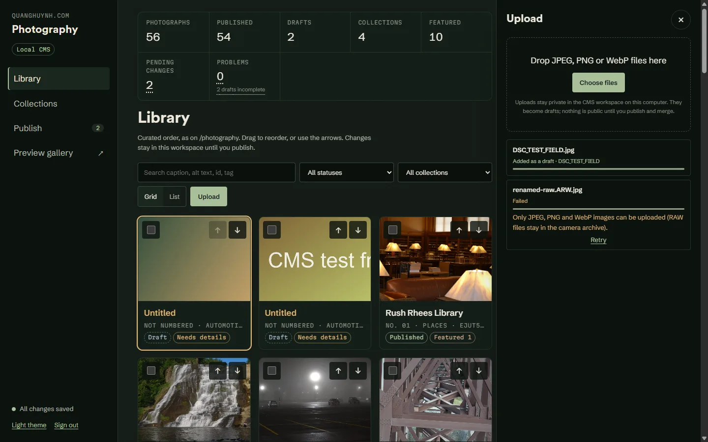
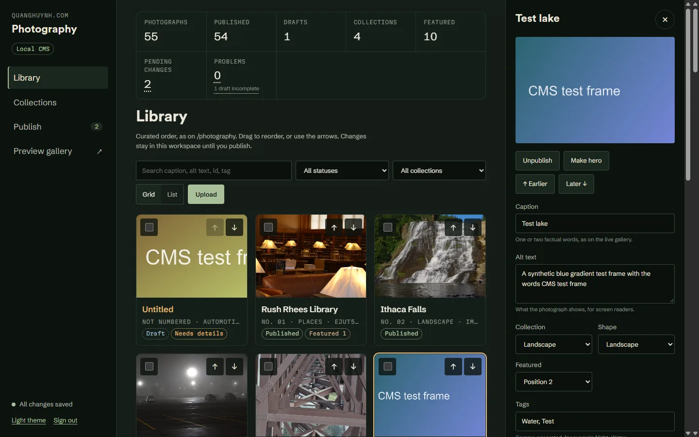
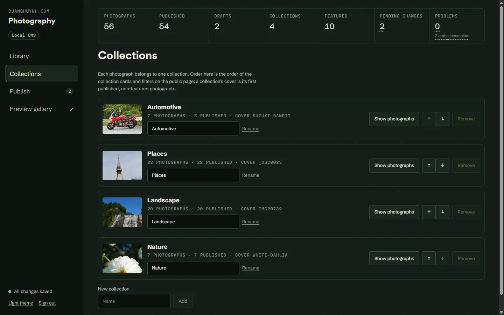
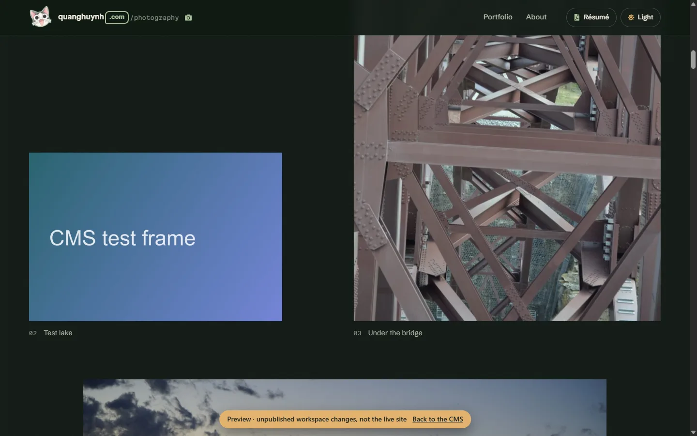
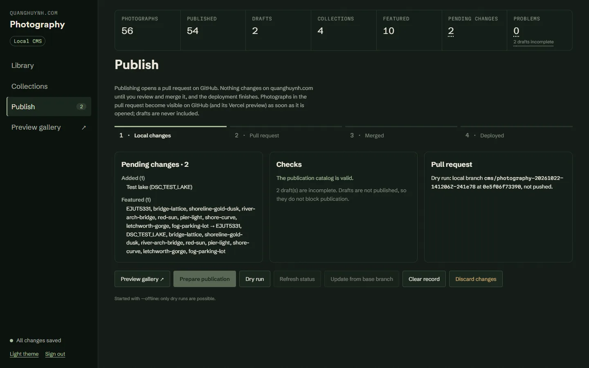

# Photography CMS

A **local-only** management tool for the photographs on
[quanghuynh.com/photography](https://quanghuynh.com/photography/). It runs on
your own computer with `npm run cms`, keeps drafts and originals in a private
folder outside the repository, and publishes by opening a GitHub pull request
that you review and merge yourself. Interval 2, 2026-10-22.

**What it is not:** there is no administration page on quanghuynh.com.
`/admin/photography` exists only on the local server
(`http://127.0.0.1:4317/admin/photography/`). The deployed site has no admin
route, no API and no CMS code, and a test checks that the build contains
none.



## Architecture decision and cost

| | A: hosted (Cloudflare Access + Worker + R2) | **B: local server + GitHub pull requests (chosen)** |
| --- | --- | --- |
| Cost | Free tiers would probably cover one owner. R2 needs billing activated on the account; Access and Workers need an account in working order. None of this could be verified: Wrangler's login on this machine has expired. | **$0.** Your computer, the existing GitHub repository, and the existing Vercel and GitHub Pages deployments. |
| Security | Strong if configured correctly: identity provider, JWT checks, private bucket. It is a new public attack surface to maintain. | **No public surface.** Loopback only, a sign-in link, session cookie, Host, Origin and CSRF checks. Secrets stay in the local process. |
| Private drafts | Private bucket | **Private folder outside the repository**, never served, built or committed |
| Maintenance | A Worker, bucket, access policy, secrets and deploys | One Node script in this repository, using the existing pipeline and tests |
| Reliability | Independent of your computer | Works whenever you are at your computer; nothing to keep running |
| Usability | From any device, anywhere | On this computer, or another machine with a checkout |

**Decision: B.** It meets every requirement without new paid
infrastructure. Option A would need account and billing setup that could
not be verified, and could be revisited later on the same catalog and
publication code.

## Setup

1. **Merge the photography work into `main` first.** The CMS publishes against
   `origin/main`, which must contain `src/data/photography.catalog.json`
   (Interval 1). Until then `npm run cms` stops with a clear message. To try
   the CMS before merging, run it offline against this branch:
   `npm run cms -- --offline --base feat/photography-cms`. In that mode only dry
   runs are possible.
2. **GitHub access.** The CMS needs a token, which stays in the server process:
   - Recommended, least privilege: create a fine-grained personal access
     token limited to `quangshuynh/portfolio`, with **Contents: Read and
     write**, **Pull requests: Read and write** and **Metadata: Read**. Start
     the CMS with it in `CMS_GITHUB_TOKEN`.
   - Fallback: the existing `gh auth login`. That token has broad `repo`
     scope, and the Publish view says so.
   - Pushing the branch uses your normal git credentials.
3. **Start it:**

   ```bash
   npm run cms
   ```

   Open the **Sign in** link it prints, and keep that link private. Options:
   - `--port 4317`
   - `--workspace <folder>`, or the `PHOTOGRAPHY_CMS_WORKSPACE` variable
     (default `~/.photography-cms/portfolio`)
   - `--base main`
   - `--remote origin`
   - `--offline`
4. **Back up the workspace folder** with your other files: it holds the
   originals of photographs you have uploaded but not yet published.

## Workflow

1. **Upload** (`Upload`, or drag files onto the panel): JPEG, PNG or WebP.
   - Each file shows progress and either succeeds or reports an error with
     Retry.
   - New photographs become **drafts** at the top of the library, with their
     images generated by the same pipeline as the public site.
   - RAW files are refused; they stay in the camera archive. Edit or export
     them first.

   
2. **Edit** a photograph's details: caption, alt text, collection, shape,
   featured position, tags, hero, and metadata corrections (or hide an
   extracted value). A published photograph's ID, slug and source file are
   fixed, so its links keep working.

   
3. **Order:**
   - Drag cards, or use ↑ and ↓ (on a card or in the details panel).
   - The order is the catalog's array order and survives reloads.
   - "No. 05" on a card is the number the public gallery will show (published
     photographs only).
4. **Collections:** move photographs between collections (in the details panel
   or with bulk actions), rename, reorder, add, and remove empty ones. A
   collection's cover is its first published, non-featured photograph, as on
   the public page.

   
5. **Publish or unpublish:** in the details panel, or in bulk. Drafts never
   leave the workspace.
6. **Preview:** opens the proposed public gallery, rendered by the real page
   components, with a "Preview" banner.

   
7. **Prepare publication** (Publish view):
   - It validates the catalog and images and checks the base branch.
   - It builds a branch in a temporary worktree, pushes it, and opens a pull
     request describing what is added, withdrawn, edited and reordered.
   - **Dry run** builds the branch locally without pushing or calling GitHub.

   
8. **Review and merge the pull request on GitHub.** CI runs on it. Merging
   deploys through the existing pipelines.
9. **Refresh status** shows whether the pull request is open, closed or
   merged, and the deployment state that GitHub reports for the merge commit
   (Vercel `Production`, `github-pages`).

The Publish view keeps four states apart:
- **local changes:** saved in the workspace only;
- **pull request:** submitted, not live;
- **merged:** on `main`;
- **deployed:** the deployment of the merge commit succeeded.

A pull request being open does not mean anything is live.

## Editing in QuangEdit

Interval 15, 2026-10-29. The full public editor (RAW, HDR, Detail, LUTs, filters,
recipes, geometry, layers, masks) opens CMS photographs; nothing is a second editor.

1. In the details panel, **Edit in QuangEdit** opens
   `/admin/photography/editor/?photo=<id>` on the CMS server, with the photograph's
   source and its saved treatment (applied when the file, matched by SHA-256, has
   loaded).
2. Edit as usual. Presets, the Filter Library, `.cube` LUTs, Copy/Paste settings and
   recipes work as on the public page: an assistant's recipe JSON is pasted, reviewed
   and applied only on Apply; a recipe's missing LUT is shown and must be reimported
   with the same SHA-256. Recipes saved in the public editor are kept per site (another
   origin), so use Recipes → **Export all** there and **Import recipes** here.
3. **Save treatment** stores the edit privately. **Render for portfolio** renders the
   full resolution from the original (JPEG 95, never resized), then generates the
   gallery and viewer images with the public pipeline (`scripts/photography-derivatives.mjs`:
   sizes, mozjpeg, no metadata). The master is named `<source>-quangedit.jpg`
   (`<reference>-HDR-quangedit.jpg` for a merge).
4. **Review in CMS**: original and edited (split, side by side, or the original's full
   frame; **Enter fullscreen** enlarges it), the settings, and
   three separate states: treatment (draft, approved, rejected), render (up to date
   or not), photograph (draft or published). **Approve for publication** needs an
   up-to-date render. **Reject** keeps the proposal for reference; **Revert to
   approved** or **Discard treatment** drops it.
5. Publish as usual. Save treatment ≠ approve ≠ publish: nothing changes on the
   live site until the publication pull request is merged.

**Sources**, best first, never copied twice and never modified:

| Source | When |
| --- | --- |
| Attached (Attach source… in the editor: JPEG, PNG, WebP, Sony ARW, DNG; up to three for an HDR merge) | stored once by SHA-256 in `sources/`, or referenced in `originals/` |
| Uploaded original | drafts uploaded to the CMS |
| Camera library | `--library-dir` set and the photograph listed in `scripts/photography-sources.mjs`: read in place |
| Public 2200 px image | nothing else: editing works and is labelled as limited; a render is never larger |

A treatment made from another file than the current source is kept and flagged
("made from a different file"), never applied to the wrong pixels. A missing or
moved source is reported, falling back to the public image with that reason.

**Treatment record** (`treatments/<id>.json`, version 1): photograph id, attached
sources, the canonical edit document (version 10, validated by the editor's own
parser, one photo, at most 4 MB, no pixels), its hash, status, the current render
(file, SHA-256, sizes, the document hash it was made from) and the approved
snapshot publication uses. Saves are atomic and revision-checked; a failed render
never touches the treatment. Renders live in `renders/<id>/<sha16>/`; unreferenced
renders and attached files are removed when a treatment changes.

**Comparison framing.** Split and side by side show the *original matched to the edit*:
the original's pixels warped through the treatment's own geometry (`cms/admin/matchedOriginal.js`,
the editor's `geometryPlan` and `warpImage`: crop, orientation, rotation, perspective,
stretch), so both images have the edit's aspect and show the same scene region at any width;
nothing is stretched. **Original, full frame** shows the uncropped original. "Original" is
the camera original at the viewer size (generated once into the private
`cache/originals/`); without a viewable original (RAW-only or the public image) the panel
says it shows the current public image, which may already be an earlier approved edit.

**Remove approved treatment** (confirmation, revision-checked) returns a photograph to its
original appearance without a neutral edit: the original's gallery and viewer images are made
now from the original file (uploaded original or camera-library JPEG/PNG/WebP) with the public
pipeline and staged in `renders/<id>/<sha16>/` as the treatment's `restore`; the edit stays as
a draft and the removal is kept in `history`. The next publication puts the original images
back under the same names (same id, slug and URLs); nothing public changes before that pull
request is merged. Approving again replaces the restore. Without an original file it is
refused. In short: **Discard** drops a working edit with nothing approved, **Revert to
approved** drops a newer working edit, **Reject** keeps a proposal for reference while the
approved one stands, **Remove approved treatment** withdraws the approved edit itself.

**Not built:** reverting to an earlier approved treatment other than the current one;
automatic HDD discovery or AI selection.

## Watermark

The **Watermark** view uses the editor's own renderer (no CMS renderer).

- **Global preference** (`<workspace>/watermark.json`, a watermark file): the
  starting point when a photo gets the watermark here or in QuangEdit ("Save as
  CMS global preference"). Each treatment stores its own resolved settings, so
  changing the preference never changes saved, approved or published photos,
  and removing an approved treatment never touches the preference. A photo's
  differences from it are shown as its overrides.
- **Apply HUYNH Watermark to Portfolio**, three separate steps:
  1. **Stage:** lists every published photograph from the catalog with a
     preview over its gallery image, source, treatment, placement and colour;
     choose photos and per-photo positions. QuangEdit then opens each in turn,
     adds the watermark to its treatment (keeping approved grading, crops,
     masks, layers), renders from the original and saves a **draft**. Progress
     is kept in this browser: stop after any photo, resume or cancel later.
  2. **Approve:** before/after (live vs staged) per photo, choose some or all,
     confirm "I compared each". Shows the estimated change (2 public images per
     photo, same names and URLs).
  3. **Publish:** the usual pull request (Publish view); only approved renders.
- **Not eligible / flagged:** no original (only the 2200 px public image), HDR
  treatments (merge manually), treatments with **unapproved edits** (would
  publish unreviewed changes). Already staged with the same settings: re-runs
  report "unchanged". The mark is one setting over the original, so re-staging
  replaces it (never stacks) and every render starts from the original (no
  generation loss). The placement check flags corners much busier than the
  picture or mid-tone backdrops: a detail/contrast heuristic on the gallery
  image, **not** face or subject detection; review flagged photos by eye.

## What publication changes

Only these paths, in a branch cut from the current `origin/main`:

- `src/data/photography.catalog.json`: the published photographs only. Drafts
  are removed entirely, so draft captions never reach the public repository.
- `src/data/photographs.generated.json`: entries added for newly published
  photographs, removed for withdrawn ones, in catalog order.
- `src/assets/photography/generated/`: derivatives created for newly
  published photographs from their private originals, and deleted for
  withdrawn ones. Deletion happens only in the branch; the live site keeps
  serving them until the merge. The 14 orphan derivatives are never touched.
  A published photograph with an **approved QuangEdit treatment** whose staged
  images differ from the base gets them under its existing names, so URLs and
  `/photography/#slug` links do not change; its manifest entry keeps the
  original's capture metadata and only its sizes change.

Anything else in the diff, or any draft's ID, source file or derivative,
stops publication before anything is committed.

## Security model

| Boundary | How it is enforced | Tested |
| --- | --- | --- |
| Network reach | Listens on `127.0.0.1` only | yes |
| Authentication | 256-bit sign-in token printed in the terminal, compared in constant time, exchanged for a random session id. Sessions live only in server memory, end at restart, and expire after 8 hours idle. | yes |
| Cookie | `HttpOnly; SameSite=Strict; Path=/` | yes |
| Direct API access | Every route, module and image needs the session. Only four files that are already public on the live site (`manifest.json`, favicons) are served without one, because browsers fetch the web manifest without cookies. | yes |
| DNS rebinding | Requests whose `Host` is not this loopback address and port are refused (421) | yes |
| CSRF | State changes need `X-CMS-Request: 1`, and a same-origin `Origin` and `Sec-Fetch-Site` when sent. No CORS is ever granted. | yes |
| GitHub token | `CMS_GITHUB_TOKEN` or `gh auth token`, held in server memory, sent only in the `Authorization` header to api.github.com. Never in the browser, a URL, the workspace or a log. | yes |
| Logs and errors | Credentials in URLs and token-shaped strings are redacted. Unknown errors show a generic message; details go to the terminal. | yes |
| Uploads | 80 MB and 120 MP limits. Type sniffed from content (JPEG, PNG, WebP), full decode required. Safe, unique file names; originals never overwritten. | yes |
| Path traversal | Image names must match `<id>-gallery.jpg` or `<id>-viewer.jpg`. Workspace folders inside the repository are refused. | yes |
| Private drafts | The workspace is outside the repository, so Vite, Git, builds, Vercel and Pages cannot see it. Draft images are served only by the authenticated local server, with `Cache-Control: private, no-store`. | yes |
| Repository visibility | The repository is public. A pushed publication branch, and its Vercel preview deployment, make **its photographs public before merge**. That is why the branch contains only photographs you chose to publish. | documented |
| GitHub Actions | No workflow was added. CI runs on pull requests from branches of this repository with the default read-only `GITHUB_TOKEN` and no secrets; deployment runs only on `main`. | audited |
| QuangEdit routes | `/admin/photography/editor/` and `/api/editor/photos/<id>/…` sit behind the same session, Host, CSRF and origin checks. Ids must match `[A-Za-z0-9_-]+` and exist in the workspace catalog; sources are served by index, never by path, `private, no-store`; no response contains a filesystem path. Attached files: content-sniffed, 200 MB; renders: decoded in full, 200 MB, 120 MP. The editor host page and `/api/editor` exist only on the CMS server (build test). | yes |
| Rate limiting | Not implemented. There is one local user, the token cannot be guessed, and failed sign-ins create nothing. | n/a |

Trust boundary: anyone who can read your terminal, your browser profile on
this computer, or your home folder can use the CMS, as they could already
use your git and GitHub credentials. The CMS adds no remote access.

## Recovery

| Problem | What happens |
| --- | --- |
| Interrupted upload | Temporary files are removed at start-up. Retrying a file reuses an original already stored, or reports it as a duplicate. |
| Duplicate file | Detected by SHA-256 and reported as "Already in the workspace". A different file with the same name gets a `name--hash.ext` file name. |
| Image generation fails | The upload fails with the pipeline's message and can be retried. |
| Invalid metadata | Saved as work in progress. Problems are listed and block only publication; incomplete drafts never block it. |
| Failed save | The edit stays on screen as "Not saved", with Retry and a browser backup offered back after a reload. Saves use revisions, so a stale tab cannot overwrite newer work. |
| Session expired | The dashboard says so; unsaved edits stay in the browser backup. |
| Base branch moved | A three-way merge applies non-conflicting changes ("Update from base branch", or automatically when publishing); conflicts are listed and nothing is pushed. |
| Push or pull request fails | The commit is kept. **Retry publication** pushes or opens the pull request without redoing it. |
| Second publication while one is open | Refused, with a link to the open pull request |
| Any failure before the commit | The temporary worktree and branch are removed |

## Tests

`npm test` runs the CMS suites alongside the site tests (345 in total on
2026-10-22). All of them are offline, and GitHub is mocked.

- `cms/lib/catalog-ops.test.mjs`: edits, persistent ordering, featured
  renumbering, draft and published transitions, collections, stable
  identities.
- `cms/lib/changes-merge.test.mjs`: change summary, a pull request
  description that never mentions a draft, three-way merge and conflicts.
- `cms/lib/uploads.test.mjs`:
  - format sniffing;
  - malformed, fake and oversized files;
  - safe names, duplicates, no overwrite;
  - retry and interrupted uploads.
- `cms/lib/publish.test.mjs` (real git repositories with a bare origin):
  - the pushed branch contains exactly the published changes and passes the
    asset report;
  - no draft text, name or file appears anywhere in it;
  - the owner's checkout is untouched;
  - dry run;
  - invalid, empty and duplicate publications;
  - a missing original;
  - a stale base merged, and a conflict;
  - push and pull request failures resumed;
  - merged and deployed status.
- `cms/server.test.mjs`:
  - unauthenticated access to every route type;
  - wrong token, cookie flags, idle expiry;
  - DNS rebinding and CSRF;
  - no secrets in responses, sign-out;
  - revisions and stale saves;
  - malformed catalogs and identity changes;
  - uploads over HTTP, image path traversal;
  - offline publication limits.
- `cms/editor.test.mjs` (QuangEdit, over HTTP): session, CSRF and origin on every
  editor route; id and source-index traversal; no paths in responses; sources
  (upload, attached RAW stored once, library read in place, moved file, public
  image only); save and reopen with masks and geometry; stale revision; invalid
  documents and another file's edits refused; render, approve, reject, revert,
  discard; stale source after reattaching; HDR needing all three exposures.
- `cms/lib/treatment-publish.test.mjs` (real git): an approved render replaces only
  that photograph's two images and manifest sizes; draft treatments, rejected
  proposals and draft photographs stay out; a new upload publishes its render with
  the original's record; no RAW, render master or workspace file in the branch; a
  render changed on disk stops publication.
- `npm run check:cms:editor`: the flow in six browser environments (see
  PROJECT_MAINTENANCE.md); on 2026-10-29 all passed, with a genuine A7 III ARW
  (6024×4024) and a merged RAW HDR (6002×4018) in Chromium.
- `cms/lib/github-preview.test.mjs`:
  - the GitHub client's auth, permission, validation and network errors;
  - deployment states, token resolution, redaction;
  - preview correctness: order, captions, new photographs, nothing
    unpublished.

Verified by hand in the browser, against the real 53-photograph catalog in
offline mode:
- sign-in and refusal;
- uploads (including a rejected fake);
- editing, publishing, featuring and reordering;
- the preview with the new photograph in Featured;
- a dry run whose branch was then built successfully, with no draft text
  anywhere in its output;
- 375 px and light theme.

More screenshots:
[mobile library](photography-cms/07-library-mobile.webp),
[mobile details](photography-cms/08-details-mobile.webp),
[light theme](photography-cms/09-library-light.webp),
[preview](photography-cms/06-preview.webp).

## Known limitations

- **Not yet run against GitHub for real.**
  - Pushes and pull requests are tested with local repositories and a mocked
    API, and a real dry run was built.
  - The first live publication should be a small one, watched end to end.
  - It needs the merge from Setup step 1.
- **Deployment status** depends on GitHub deployments: Vercel's `Production`
  environment and `github-pages`.
- **Drag and drop** uses the browser's native drag events, which phones do not
  support; the arrow buttons cover touch screens and keyboards.
- The **Featured layout** looks best with 1, 3, 4, 6, 7 or 9 photographs whose
  shapes fit its row slots. The CMS shows positions but does not enforce
  this; check the preview.
- **One collection per photograph**, and covers follow order (no explicit
  cover field). Both are as in the catalog schema.
- **No HEIC, TIFF or RAW uploads.** The editor (a later interval) is the route
  for RAW.
- Upload previews are generated once; if the image pipeline changes, publishing
  regenerates the public derivatives from the original anyway.
- **Withdrawing** a photograph removes it from the public catalog; it stays in
  the workspace as a draft. Its old URL `/photography/#slug` then opens the
  gallery without a viewer, as it does for any unknown slug.
- The workspace is **not backed up automatically**, and the CMS has **one
  owner**: there is no multi-user locking beyond the revision check.
- **QuangEdit in the CMS** is not checked on a physical iPhone (emulation only).
  Saved recipes and presets of the public editor are per site (export/import them).
  The original-versus-edited comparison overlays two images, so a crop shows them
  misaligned. The CMS's Vite client retries its disabled HMR socket on loopback
  port 24678 (harmless, never leaves the computer).
